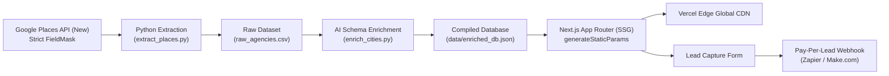

# Local SEO Lead Engine: Dental Marketing pSEO Platform

> **Technical Blueprint & Execution Plan for Programmatic Web Assets**  
> A high-performance programmatic SEO (pSEO) engine leveraging Python automation, Google Places API (New), LLM enrichment, and Next.js Static Site Generation (SSG) with Tailwind CSS.

---

## 🏗️ Architecture Overview



---

## 📁 Project Structure

```
dental-seo-engine/
├── app/
│   ├── layout.tsx                     # Global layout, header, footer, SEO metadata
│   ├── globals.css                    # Tailwind CSS directives
│   ├── page.tsx                       # Homepage directory & market grid
│   ├── api/
│   │   └── leads/
│   │       └── route.ts               # Lead dispatch & webhook forwarder
│   └── dental-agencies/
│       └── [city]/
│           └── page.tsx               # Dynamic SSG template, schema markup, FAQ & listings
├── components/
│   ├── AgencyCard.tsx                 # Verified agency card with reviews & badges
│   ├── FaqAccordion.tsx               # Interactive FAQ component
│   ├── LeadCaptureForm.tsx            # Pay-Per-Lead capture modal/form
│   ├── Header.tsx                     # Sticky navigation bar
│   └── Footer.tsx                     # Directory footer
├── data/
│   ├── raw_agencies.csv               # Extracted Google Places CSV
│   └── enriched_db.json               # Final LLM-enriched JSON database
├── scripts/
│   ├── extract_places.py              # Google Places API (New) headless extractor
│   ├── enrich_cities.py               # AI market summary & FAQ generator
│   └── requirements.txt               # Python dependencies
├── tailwind.config.ts
├── postcss.config.mjs
├── tsconfig.json
├── package.json
└── README.md
```

---

## ⚡ Quick Start Guide

### 1. Run Data Extraction & Enrichment (Python)

Install Python dependencies:
```bash
cd scripts
pip install -r requirements.txt
cd ..
```

Run extraction (supports `--mock` flag if you want to test without an active Google Places API key):
```bash
# Extract with mock or live Google Places API
python scripts/extract_places.py --mock --out data/raw_agencies.csv

# Enrich raw data with unique 300-word market summaries and FAQs
python scripts/enrich_cities.py --csv data/raw_agencies.csv --out data/enriched_db.json
```

### 2. Run the Next.js Frontend

Install npm dependencies:
```bash
npm install
```

Start the development server:
```bash
npm run dev
```
Open [http://localhost:3000](http://localhost:3000) in your browser.

Test the pre-rendered dynamic city pages:
- [http://localhost:3000/dental-agencies/dallas](http://localhost:3000/dental-agencies/dallas)
- [http://localhost:3000/dental-agencies/austin](http://localhost:3000/dental-agencies/austin)
- [http://localhost:3000/dental-agencies/miami](http://localhost:3000/dental-agencies/miami)

### 3. Build Static Pages (SSG Production Build)

```bash
npm run build
```
Next.js will statically pre-render all city routes via `generateStaticParams()` into flat HTML files ready for Vercel Edge CDN distribution.

---

## 💰 Monetization & Pay-Per-Lead (PPL) Pipeline

When a practice requests quotes via `LeadCaptureForm`:
1. The submission posts to `/api/leads`.
2. The server parses the lead details (practice name, contact, procedure goal, monthly budget).
3. If `LEAD_WEBHOOK_URL` is set in `.env.local`, it dispatches the lead directly to Zapier or Make.com.
4. Your webhook routes partial lead details to the top 3 agencies for that city alongside a Stripe payment link to unlock the full contact details ($50–$150/lead).
